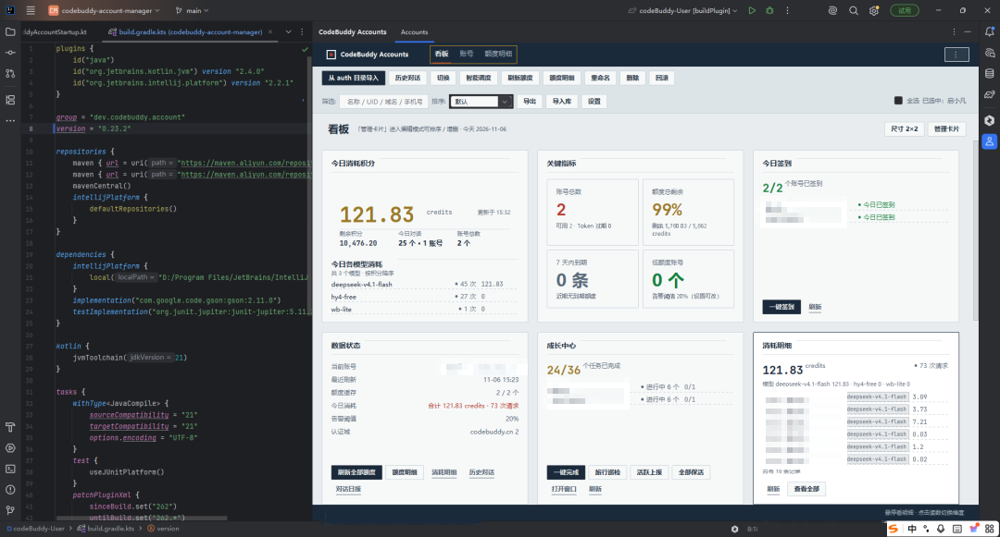
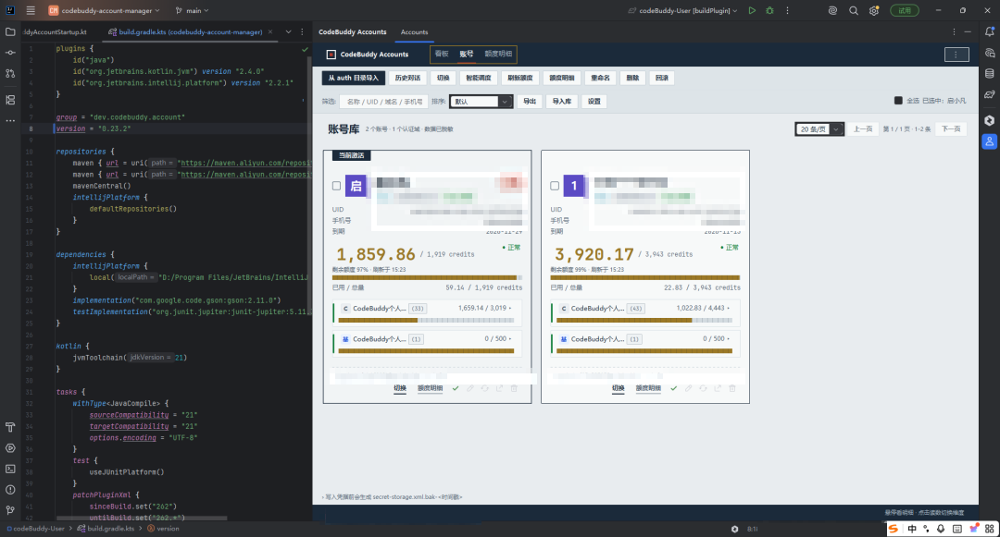

# CodeBuddy Account Manager

JetBrains IDE 插件：在本地统一管理多个 **CodeBuddy（coding-copilot-jetbrains）** 账号——批量导入凭据、一键切号与回滚、额度监控与明细、跨账号历史对话浏览与合并，并把这些信息集中显示在 IDE 状态栏。

> 本插件是运行在 JetBrains IDE 内的独立工具，不是 CodeBuddy 官方组件。它直接读写本机已有的 CodeBuddy 凭据文件，不会把凭据上传到任何服务器。

当前版本：**0.24.1**（2026-11-09）。源码仓库：<https://github.com/qiXiaoFanTomato/codebuddy-account-manager>。界面静态预览：[产品落地页](https://qixiaofantomato.github.io/codebuddy-account-manager/) · [插件界面复刻页](https://qixiaofantomato.github.io/codebuddy-account-manager/plugin-ui.html)。





## 功能

### 账号库
- **从 auth 目录导入**：自动识别 WorkBuddy 桌面端 auth 目录下的 `.info` 凭据快照，同时读取当前 IDE 中 CodeBuddy 插件已登录的凭据（`options/secret-storage.xml`）。
- **自动归档**：首次启动静默导入一次，并监听 `secret-storage.xml`，官方入口登录/切号后 1.5 秒自动归档为历史快照。
- **卡片式列表**：显示头像、别名、`当前` 徽标、企业/个人标签、手机号、认证域、Token 状态与额度进度条。
- **看板**：账号总数、额度总剩余、7 天内到期细项、低额度账号数四个指标；今日主指标用加大号数字展示「今日消耗积分」并在右侧给出「剩余积分」；另有今日对话、今日签到、今日消耗明细卡片、账号额度排行、30 天到期看板（按套餐类型合并）与数据状态；每张卡片都可点击跳转到对应功能页。
- **今日签到 / 一键签到**：对账号库中所有账号执行每日签到，卡片按本地按日记录展示各账号今日是否已签与本次签到结果。该功能依赖的接口**不是官方公开接口**（对齐 workbuddy2api-panel 的 daily-checkin 口径，客户端内未内置），路径可在设置页修改或整体关闭，失败只提示不影响账号。
- **成长中心任务 / 一键完成**：接入 WorkBuddy / CodeBuddy 成长计划（成长中心）任务，逐账号展示任务完成数、待领奖数量与进行中进度；「一键完成」= 接取未接取任务 + 上报客户端行为事件自动完成可自动化的任务 + 领取已达标的奖励。
- **成长中心窗口**：首页看板「打开窗口」进入独立窗口，顶部可切换账号（默认全部账号），提供「一键完成 / 旅行巡检 / 活跃上报 / 全部保活 / 连登兑换 / 抽奖 / 补签昨日 / 刷新」按钮，下方是任务明细表；双击某行即对该任务执行一键完成，需在客户端完成的任务会尝试打开其跳转链接。
- **成长任务快捷入口**：账号卡片底部新增「一键完成成长任务」图标，只处理该账号；看板成长中心卡片也提供旅行巡检 / 活跃上报 / 全部保活。
- 上述接口同样**不是官方公开接口**（来自官方前端包与客户端行为上报协议的逆向整理），路径与可选企业 ID 可在设置页修改或整体关闭；「一键完成」里的行为上报类任务可在设置页单独关闭。
- **筛选与排序**：按名称 / UID / 域名 / 手机号筛选；排序支持 `默认`、`按域名分组`、`按过期时间`、`按剩余额度`、`按昵称`。
- **导入 / 导出**：账号库可导出为 JSON 备份并重新导入（导出文件含完整凭据，需自行妥善保管）。
- **重命名与删除**：为账号设置别名；当前激活账号不可删除。

### 切换与回滚
- **切换**：把选定账号的凭据写回 IDE 的 `secret-storage.xml`（写入前自动生成 `.bak-<时间戳>` 备份），重启 IDE 后 CodeBuddy 插件生效。
- **回滚**：一键恢复上一次切换前的凭据。
- **强制登出**：清除 IDE 中 CodeBuddy 的登录态。
- **待生效补偿**：若 IDE 退出时用内存旧值覆盖了凭据，下次启动自动补写并提示再重启一次。
- **智能调度**：优先消耗即将过期的额度，其次选择剩余额度最多的账号，推荐并执行切换。
- **热切换（实验特性）**：通过反射调用 CodeBuddy 插件内部桥接，尝试不重启 IDE 生效；任何一步校验失败会安全降级并提示重启。

### 额度
- **自动刷新**：可设置刷新间隔区间（最小 ~ 最大分钟，0 表示关闭，默认 15 ~ 15 分钟），后台每次在区间内随机取一个整数分钟数作为下次刷新间隔。
- **额度明细窗口**：每个账号一张卡片，卡片内按套餐分组（含进度条、已用 / 总量、百分比）折叠展开细项，细项显示已用量与到期时间；多账号纵向排列。
- **消耗明细**：按账号 + 时间范围（今天 / 近 7 天 / 近 30 天）拉取每次请求的时间、产品、模型、积分、使用端与提示词摘要，顶部给出合计积分与模型分布，表格内分页；对应网页版「消耗明细」页。
- **低额度提醒**：低于阈值（默认 20%）时弹通知，每个账号每个周期只提醒一次，额度恢复后自动重置。
- **自动调度**：开启后当前账号额度低于阈值（默认 10%）自动切换到更富裕的账号，冷却 10 分钟。
- **状态栏**：显示 `CodeBuddy: <账号名> · <额度>`，额度维度可选 `总剩余百分比`、`剩余 / 总量`、`各套餐摘要`、`最紧张套餐`、`指定套餐`；额度数值下降时以平滑递减动画呈现；悬停查看明细，点击打开面板。
- **模型限额**：统计周期（今天 / 本月）内各目标模型的积分消耗，**支持同时监控多个模型，每个模型一条独立限额**（如 deepseek 200、gpt-5 100）；看板卡片逐条展示已用 / 限额、剩余、进度条与超限账号；某条规则累计达到限额时弹通知提示切换账号，剩余低于阈值时对当前账号预警。规则、统计周期与预警阈值均可在设置页调整；规则里的模型从 CodeBuddy 模型目录下拉选择（`GET /v3/config`，与官方 IDE 同源），也可手填关键字（如 `deepseek` 覆盖整个系列）。

### 历史对话
- **跨账号浏览**：扫描各账号 `history/<工作区>/index.json`，按 `今天` / `昨天` / `最近 7 天` / `更早` 分组，支持关键字搜索与按账号过滤。
- **查看与导出**：消息按 `createdAt` 排序、解包嵌套的 message JSON，文本与工具调用分块渲染（工具结果只显示摘要），可复制、导出为 Markdown、打开会话所在目录。
- **历史共享到当前**：把全部账号的会话索引合并进当前激活账号，并复制目标账号缺失的消息目录（只新增，不覆盖、不删除）。
- **批量同步全部**：所有账号互相合并历史。
- **对话日报 / 周报**：基于本地历史会话生成今日日报与本周周报，默认按项目统计（项目名由会话消息里的路径反推，解析不到时显示为 `项目 <hash 前 8 位>`），另有账号 / 日期 / 时段 / 会话类型维度；左侧维度分布条与「今天 / 昨天 / 本周」快捷按钮都可点击筛选右侧明细，可复制 Markdown。
- **用 CodeBuddy 生成**：只把区间、git 命令与口径写成简短指令复制到剪贴板并打开 CodeBuddy 对话窗口，由 CodeBuddy 在当前项目根目录自行执行 git log 读取区间内已 commit 的记录（提交说明 + 变更文件），以最近一条提交的 Author 为本人自动区分自己 / 他人提交后生成日报 / 周报正文；无需填写身份或路径，当前项目不写死绝对路径，仅报告中出现其它项目目录时才列出完整命令；不搬运提交数据，避免大量变更文件导致粘贴内容截断，未提交的工作区改动不计入。

### 设置
`Settings | Tools | CodeBuddy 账号管理器`：

| 设置项 | 默认值 |
| --- | --- |
| 配额自动刷新间隔（分钟，最小 ~ 最大，0 表示关闭） | 15 ~ 15 |
| 剩余额度低于阈值时提醒 / 阈值（%） | 开启 / 20 |
| 切换账号时默认同步历史会话索引 | 开启 |
| 同步时复制目标账号缺失的消息目录 | 开启 |
| 「刷新额度」未选中账号时刷新全部账号 | 开启 |
| 切号时尝试热切换（实验特性） | 关闭 |
| 当前账号额度低于阈值时自动调度到其他账号 / 触发阈值（%） | 关闭 / 10 |
| 在状态栏显示当前账号与剩余额度（立即生效） | 开启 |
| 状态栏额度维度 | 总剩余百分比 |
| 启动时检查 token 过期并提醒 | 开启 |
| 监控模型积分限额（达标后提醒切号） | 开启 |
| 模型限额规则（模型从 CodeBuddy 目录下拉选择 + 限额积分，可多模型） | deepseek = 200 |
| 统计周期（今天 / 本月） | 本月 |
| 接近限额预警阈值（剩余 %） | 20 |

## 环境要求

- **Windows**：插件依赖 `%LOCALAPPDATA%\CodeBuddyExtension\Data`（WorkBuddy 桌面端数据目录）与 JetBrains 配置目录，其他平台无对应实现。
- **IntelliJ IDEA 2026.2**（`sinceBuild = 262`，`untilBuild = 262.*`）。
- 已安装 **CodeBuddy 插件**（插件 id `com.tencent.cloud.codingcopilot`），并至少登录过一个账号。

## 安装

### 从 JetBrains Marketplace 安装

`Settings | Plugins | Marketplace` 搜索 **CodeBuddy Account Manager** → Install → 重启 IDE。

### 本地安装

```powershell
# 生成插件包：build/distributions/codebuddy-account-manager-<version>.zip
.\gradlew.bat buildPlugin
```

`Settings | Plugins | 齿轮 | Install Plugin from Disk...` 选择该 zip，重启 IDE。

## 使用流程

1. 打开工具窗：`Tools | CodeBuddy Account Manager`，或点击状态栏 `CodeBuddy: ...`。
2. 首次打开点击 **从 auth 目录导入**，把已有账号加入账号库。
3. 选中卡片后点击 **切换**（会询问是否同步历史），按提示重启 IDE 生效。
4. 点击 **刷新额度** 或 **额度明细** 查看用量；需要长期监控时在设置页开启自动刷新与低额度提醒。
5. 需要合并会话时使用 **历史共享到当前** 或 **批量同步全部**，同步后重启 IDE 让 CodeBuddy 侧边栏刷新。

## 数据与隐私

- 凭据快照保存在 IDE 配置目录 `<IDE config>/codebuddy-accounts/`（`index.json`、`snapshots/<uid>@<domain>.info`、`quota-cache.json`）。
- 写入 `secret-storage.xml` 前会生成 `secret-storage.xml.bak-<时间戳>`；覆盖历史索引前会生成 `index.json.bak`。
- 额度查询直接请求 `https://<domain>/v2/billing/meter/get-user-resource`，消耗明细请求 `https://<domain>/billing/meter/get-user-request-usage`，仅在本地与 CodeBuddy 服务端之间通信。
- 成长中心任务请求 `https://copilot.tencent.com/v2/activity/growth/tasks`（含 `/accept`）、领奖 `https://www.workbuddy.cn/activity/growth/tasks/<task_code>/claim`，旅行 / 连登 / 抽奖 / 补签在 `copilot.tencent.com/activity/growth/*`，活跃上报在 `www.codebuddy.cn/v2/report`，保活刷新在 `copilot.tencent.com/v2/plugin/auth/token/refresh`；global 账号（workbuddy.ai）走 `https://www.workbuddy.ai`。全部只与官方服务端通信，不经过任何第三方。
- 插件不上传、不代理任何账号数据；导出的 JSON 与 Markdown 由用户自行保管。

## 构建

```powershell
# JDK 21（gradle.properties 中可通过 org.gradle.java.installations.paths 指向本地 JDK）
.\gradlew.bat buildPlugin     # 打包
.\gradlew.bat runIde          # 在沙箱 IDE 中调试运行
```

构建使用本地安装的 IntelliJ IDEA 2026.2 作为开发目标，因此需要先把 `build.gradle.kts` 中的依赖路径改为本机安装目录：

```kotlin
dependencies {
    intellijPlatform {
        local("C:/Program Files/JetBrains/IntelliJ IDEA 2026.2.0.1")
        // 或改为从 JetBrains 仓库下载：
        // intellijIdeaCommunity("2026.2")
    }
}
```

`gradle.properties` 中的 `org.gradle.java.installations.paths` 与 `tools/`、`tmp/`、`*.zip` 等本地工具链目录已被 `.gitignore` 忽略，克隆后按本机环境重新配置即可。

## 发布与更新

版本号、变更说明、`buildPlugin` / `publishPlugin` 与网页上传的完整步骤见 [docs/release.md](docs/release.md)。

插件主页：<https://plugins.jetbrains.com/plugin/35719-codebuddy-account-manager>

界面预览页（GitHub Pages，`main` 分支 `/docs`）：

- 产品落地页：<https://qixiaofantomato.github.io/codebuddy-account-manager/>
- 插件界面复刻页：<https://qixiaofantomato.github.io/codebuddy-account-manager/plugin-ui.html>

## 已知限制

- 常规切号必须重启 IDE：CodeBuddy 插件启动时读取凭据并缓存。
- 热切换依赖 CodeBuddy 插件内部类（`...secretstate.SecretStorage`、`ResetPluginStatusAction`），CodeBuddy 版本变更时会降级为需要重启。
- 同一 UID 在不同域名下视为不同账号（主键 `uid@domain`）。
- 历史同步只处理目标账号已存在的工作区目录，只新增不覆盖；单个会话消息复制上限 2000 个文件。
- 设置页与动作未参与 IDE 全局搜索索引（`buildSearchableOptions` 已关闭）。
- 模型限额监控只统计客户端上报的消耗明细并做预警，无法拦截 CodeBuddy 客户端的模型调用；是否禁用模型以官方服务端规则为准。

## 反馈

源码仓库与版本更新：<https://github.com/qiXiaoFanTomato/codebuddy-account-manager>。

发现问题或有功能建议，请统一到 [GitHub Issues](https://github.com/qiXiaoFanTomato/codebuddy-account-manager/issues) 反馈，并附 IDE 版本、CodeBuddy 插件版本与复现步骤（请勿粘贴 token 等凭据内容）。

## License

本项目暂未指定开源许可证。如需在衍生项目或商业场景中使用，请先联系作者。
