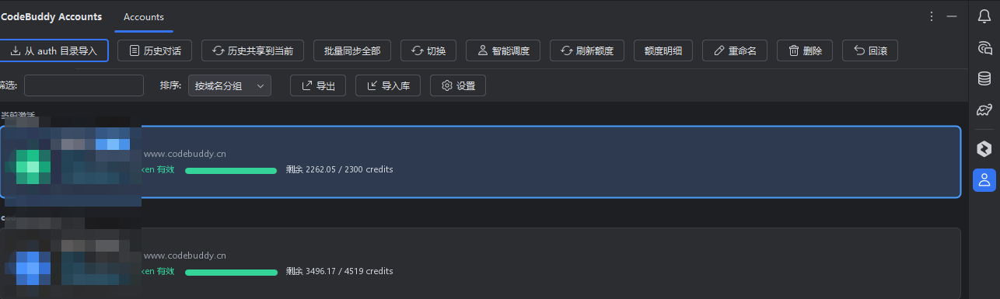

# CodeBuddy Account Manager

JetBrains IDE 插件：在本地统一管理多个 **CodeBuddy（coding-copilot-jetbrains）** 账号——批量导入凭据、一键切号与回滚、额度监控与明细、跨账号历史对话浏览与合并，并把这些信息集中显示在 IDE 状态栏。

> 本插件是运行在 JetBrains IDE 内的独立工具，不是 CodeBuddy 官方组件。它直接读写本机已有的 CodeBuddy 凭据文件，不会把凭据上传到任何服务器。



## 功能

### 账号库
- **从 auth 目录导入**：自动识别 WorkBuddy 桌面端 auth 目录下的 `.info` 凭据快照，同时读取当前 IDE 中 CodeBuddy 插件已登录的凭据（`options/secret-storage.xml`）。
- **自动归档**：首次启动静默导入一次，并监听 `secret-storage.xml`，官方入口登录/切号后 1.5 秒自动归档为历史快照。
- **卡片式列表**：显示头像、别名、`当前` 徽标、企业/个人标签、手机号、认证域、Token 状态与额度进度条。
- **筛选与排序**：按名称 / UID / 域名 / 手机号筛选；排序支持 `默认`、`按域名分组`、`按过期时间`、`按剩余额度`、`按昵称`。
- **导入 / 导出**：账号库可导出为 JSON 备份并重新导入（导出文件含完整凭据，需自行妥善保管）。
- **重命名与删除**：为账号设置别名；当前激活账号不可删除。

### 切换与回滚
- **切换**：把选定账号的凭据写回 IDE 的 `secret-storage.xml`（写入前自动生成 `.bak-<时间戳>` 备份），重启 IDE 后 CodeBuddy 插件生效。
- **回滚**：一键恢复上一次切换前的凭据。
- **强制登出**：清除 IDE 中 CodeBuddy 的登录态。
- **待生效补偿**：若 IDE 退出时用内存旧值覆盖了凭据，下次启动自动补写并提示再重启一次。
- **智能调度**：优先消耗即将过期的额度，其次选择剩余额度最多的账号，推荐并执行切换。
- **热切换（实验特性）**：通过反射调用 CodeBuddy 插件内部桥接，尝试不重启 IDE 生效；任何一步校验失败会安全降级并提示重启。

### 额度
- **自动刷新**：可设置刷新间隔（0 表示关闭，默认 15 分钟），由后台服务排程。
- **额度明细窗口**：总剩余 / 总量、百分比、套餐分组折叠展开、每条细项的已用量与到期时间、多账号汇总视图。
- **低额度提醒**：低于阈值（默认 20%）时弹通知，每个账号每个周期只提醒一次，额度恢复后自动重置。
- **自动调度**：开启后当前账号额度低于阈值（默认 10%）自动切换到更富裕的账号，冷却 10 分钟。
- **状态栏**：显示 `CodeBuddy: <账号名> · <额度>`，额度维度可选 `总剩余百分比`、`剩余 / 总量`、`各套餐摘要`、`最紧张套餐`、`指定套餐`；悬停查看明细，点击打开面板。

### 历史对话
- **跨账号浏览**：扫描各账号 `history/<工作区>/index.json`，按 `今天` / `昨天` / `最近 7 天` / `更早` 分组，支持关键字搜索与按账号过滤。
- **查看与导出**：右侧等宽字体展示消息内容，可复制、导出为 Markdown、打开会话所在目录。
- **历史共享到当前**：把全部账号的会话索引合并进当前激活账号，并复制目标账号缺失的消息目录（只新增，不覆盖、不删除）。
- **批量同步全部**：所有账号互相合并历史。

### 设置
`Settings | Tools | CodeBuddy 账号管理器`：

| 设置项 | 默认值 |
| --- | --- |
| 配额自动刷新间隔（分钟，0 表示关闭） | 15 |
| 剩余额度低于阈值时提醒 / 阈值（%） | 开启 / 20 |
| 切换账号时默认同步历史会话索引 | 开启 |
| 同步时复制目标账号缺失的消息目录 | 开启 |
| 「刷新额度」未选中账号时刷新全部账号 | 开启 |
| 切号时尝试热切换（实验特性） | 关闭 |
| 当前账号额度低于阈值时自动调度到其他账号 / 触发阈值（%） | 关闭 / 10 |
| 在状态栏显示当前账号与剩余额度（立即生效） | 开启 |
| 状态栏额度维度 | 总剩余百分比 |
| 启动时检查 token 过期并提醒 | 开启 |

## 界面预览

| 额度明细 | 历史对话 |
| --- | --- |
|  |  |

| 设置页 | 状态栏 |
| --- | --- |
|  |  |

## 环境要求

- **Windows**：插件依赖 `%LOCALAPPDATA%\CodeBuddyExtension\Data`（WorkBuddy 桌面端数据目录）与 JetBrains 配置目录，其他平台无对应实现。
- **IntelliJ IDEA 2026.2**（`sinceBuild = 262`，`untilBuild = 262.*`）。
- 已安装 **CodeBuddy 插件**（插件 id `com.tencent.cloud.codingcopilot`），并至少登录过一个账号。

## 安装

### 从 JetBrains Marketplace 安装

`Settings | Plugins | Marketplace` 搜索 **CodeBuddy Account Manager** → Install → 重启 IDE。

### 本地安装

```powershell
# 生成插件包：build/distributions/codebuddy-account-manager-<version>.zip
.\gradlew.bat buildPlugin
```

`Settings | Plugins | 齿轮 | Install Plugin from Disk...` 选择该 zip，重启 IDE。

## 使用流程

1. 打开工具窗：`Tools | CodeBuddy Account Manager`，或点击状态栏 `CodeBuddy: ...`。
2. 首次打开点击 **从 auth 目录导入**，把已有账号加入账号库。
3. 选中卡片后点击 **切换**（会询问是否同步历史），按提示重启 IDE 生效。
4. 点击 **刷新额度** 或 **额度明细** 查看用量；需要长期监控时在设置页开启自动刷新与低额度提醒。
5. 需要合并会话时使用 **历史共享到当前** 或 **批量同步全部**，同步后重启 IDE 让 CodeBuddy 侧边栏刷新。

## 数据与隐私

- 凭据快照保存在 IDE 配置目录 `<IDE config>/codebuddy-accounts/`（`index.json`、`snapshots/<uid>@<domain>.info`、`quota-cache.json`）。
- 写入 `secret-storage.xml` 前会生成 `secret-storage.xml.bak-<时间戳>`；覆盖历史索引前会生成 `index.json.bak`。
- 额度查询直接请求 `https://<domain>/v2/billing/meter/get-user-resource`，仅在本地与 CodeBuddy 服务端之间通信。
- 插件不上传、不代理任何账号数据；导出的 JSON 与 Markdown 由用户自行保管。

## 构建

```powershell
# JDK 21（gradle.properties 中可通过 org.gradle.java.installations.paths 指向本地 JDK）
.\gradlew.bat buildPlugin     # 打包
.\gradlew.bat runIde          # 在沙箱 IDE 中调试运行
```

构建使用本地安装的 IntelliJ IDEA 2026.2 作为开发目标，因此需要先把 `build.gradle.kts` 中的依赖路径改为本机安装目录：

```kotlin
dependencies {
    intellijPlatform {
        local("C:/Program Files/JetBrains/IntelliJ IDEA 2026.2.0.1")
        // 或改为从 JetBrains 仓库下载：
        // intellijIdeaCommunity("2026.2")
    }
}
```

`gradle.properties` 中的 `org.gradle.java.installations.paths` 与 `tools/`、`tmp/`、`*.zip` 等本地工具链目录已被 `.gitignore` 忽略，克隆后按本机环境重新配置即可。

## 已知限制

- 常规切号必须重启 IDE：CodeBuddy 插件启动时读取凭据并缓存。
- 热切换依赖 CodeBuddy 插件内部类（`...secretstate.SecretStorage`、`ResetPluginStatusAction`），CodeBuddy 版本变更时会降级为需要重启。
- 同一 UID 在不同域名下视为不同账号（主键 `uid@domain`）。
- 历史同步只处理目标账号已存在的工作区目录，只新增不覆盖；单个会话消息复制上限 2000 个文件。
- 设置页与动作未参与 IDE 全局搜索索引（`buildSearchableOptions` 已关闭）。

## 反馈

发现问题请提交 Issue，并附 IDE 版本、CodeBuddy 插件版本与复现步骤（请勿粘贴 token 等凭据内容）。

## License

见仓库中的 `LICENSE` 文件。
